<h1 align="center">OpenGen</h1>

<p align="center">
  
  
  
  
</p>

<p align="center">
  <strong>Local sandboxes for AI agents and the apps that run them.</strong><br/>
  Run commands and keep project files in locked-down Docker containers, from a CLI, a loopback HTTP API or a small JavaScript client.
</p>

<p align="center">
  
</p>

OpenGen is an independently usable, open-source execution runtime. Local use does not require a Genisys
account, a paid subscription or an AI provider key. The initial release is a **single-owner local developer
runtime**: it is not an audited security product, a microVM runtime or a shared hosted service. Read
[SECURITY.md](SECURITY.md) before running untrusted workloads.

Every recording below is a real session against a local Docker daemon, captured by
[`npm run readme:record`](scripts/record-readme.mjs); nothing in them is typed by hand.

## Features

<table>
<tr>
<td width="42%" valign="middle">

### Locked down by default

Containers run as a non-root user on a read-only root filesystem, with CPU, memory and process limits, and no network unless the operator allows it.

[Security →](SECURITY.md#controls-implemented-by-the-docker-adapter)

</td>
<td width="58%">
  
</td>
</tr>
<tr>
<td width="42%" valign="middle">

### Files that stay put

The managed workspace survives stop, start and reset. Reset recreates the container, not your files; deletion is a separate, explicit step.

[Docs →](docs/LOCAL.md#create-run-and-inspect)

</td>
<td width="58%">
  
</td>
</tr>
<tr>
<td width="42%" valign="middle">

### Every command has a deadline

A command that runs past its timeout is stopped along with its sandbox, so a runaway process cannot keep running. Start it again when you are ready.

[Docs →](docs/API.md#execute)

</td>
<td width="58%">
  
</td>
</tr>
<tr>
<td width="42%" valign="middle">

### Local previews

Allow networking for a sandbox, start a dev server inside it, and open it on a loopback-only URL on your machine.

[Docs →](docs/LOCAL.md#local-application-previews)

</td>
<td width="58%">
  
</td>
</tr>
<tr>
<td width="42%" valign="middle">

### Drive it from your own app

A small JavaScript client with TypeScript declarations covers create, write, run, stop, reset and delete, from a trusted backend process.

[Docs →](docs/INTEGRATION.md#javascript-example)

</td>
<td width="58%">
  
</td>
</tr>
<tr>
<td width="42%" valign="middle">

### An API that stays on your machine

The HTTP API listens on 127.0.0.1 only, needs the owner token on every call, and refuses requests that come from a web page.

[API →](docs/API.md)

</td>
<td width="58%">
  
</td>
</tr>
</table>

OpenGen does not include an AI model, hosted compute, a browser automation engine, a graphical terminal or
remote-device connectivity; a client application builds those on the runtime. The backend calls Docker directly.
OpenSandbox and microVM backends are future candidates, not implemented adapters.

## Run from source

You need Node.js 24, npm, Git, and access to a local Docker daemon running Linux
containers. Use a dedicated development environment for workloads you do not
trust. Docker Desktop users should review its separate installation and licensing
requirements; OpenGen does not redistribute Docker Desktop.

```sh
git clone https://github.com/athompson83/opengen.git
cd opengen
npm ci --ignore-scripts
npm run images:build
node bin/opengen.mjs init
npm run doctor
npm start
```

The API listens on `127.0.0.1:47831` by default. Initialization creates local
configuration and an authentication token in the OpenGen state directory. Keep
the token private; it grants access to every sandbox owned by this runtime.
The CLI uses that local configuration. See [local operation](docs/LOCAL.md) for
commands, configuration, and recovery.

The provided image build refreshes its base image and requires internet access.
Once the image is built, disconnected workloads can run with locally available
tools and files. Package downloads, remote models, and external services still
need network access and may have their own costs.

## Use from another application

The public interface supports sandbox creation, command execution, file access,
stop/start, reset, deletion, and local previews. Use the JavaScript client or the
HTTP API from a trusted local backend process. Direct browser requests are
rejected.

- [API contract](docs/API.md)
- [Client application integration](docs/INTEGRATION.md)
- [Architecture](ARCHITECTURE.md)

Genisys users can follow the [OpenGen developer guide](https://genisys.aroqon.com/developers/opengen/)
for setup and the separate developer-console connection. The console is delivered
with Genisys; this repository does not install or upgrade that application.
**OpenGen stays free and independent. Genisys Local Mode is a separate paid app
offering.** No proprietary application source or paid service is required by OpenGen.

## Verify

```sh
npm run check
npm run images:build
npm run test:docker
```

`check` verifies source behavior without a Docker daemon (including that every image this README shows exists). `test:docker` requires a
real local Linux Docker daemon and the built image; it exercises container
configuration, lifecycle, file persistence, timeouts, project boundaries, and
preview binding. See [verification](docs/VERIFICATION.md) for what the evidence
does and does not establish.

After a change to the CLI, API or image, re-record the feature demos with `npm run readme:record` (it needs Docker,
bash, curl and jq, uses a private state directory, and deletes its sandboxes) and commit the updated SVGs.

CI runs one bounded Ubuntu job on relevant code changes. It does not run paid
models, publish images, or deploy infrastructure. Native Windows and macOS
compatibility must be validated separately; passing Linux CI is not evidence that
all desktop configurations work.

## License and contributions

OpenGen is licensed under [Apache-2.0](LICENSE). The original repository license
is preserved. See [NOTICE](NOTICE) and [third-party provenance](docs/THIRD_PARTY.md)
for external components. See [CONTRIBUTING.md](CONTRIBUTING.md) to contribute and
[SECURITY.md](SECURITY.md) to report security issues.
