<p align="center">
  
</p>

<p align="center">
  
  
  
  
</p>

<p align="center">
  <strong>Run commands and keep project files in locked-down Docker containers,</strong><br/>
  from a CLI, a loopback HTTP API or a small JavaScript client.
</p>

<p align="center">
  <a href="#quick-start">Quick start</a> ·
  <a href="#tutorials">Tutorials</a> ·
  <a href="#features">Features</a> ·
  <a href="#screenshots">Screenshots</a> ·
  <a href="#the-genisys-app">Genisys app tutorials</a> ·
  <a href="#connections">Connections</a> ·
  <a href="#contributing">Contributing</a>
</p>

<p align="center">
  
</p>

OpenGen is an independently usable, open-source execution runtime. Local use does not require a Genisys
account, a paid subscription or an AI provider key. The initial release is a **single-owner local developer
runtime**: it is not an audited security product, a microVM runtime or a shared hosted service. Read
[SECURITY.md](SECURITY.md) before running untrusted workloads.

Every terminal recording and tutorial on this page is a real session against a local Docker daemon, captured by
[`npm run readme:record`](scripts/record-readme.mjs). Nothing in them is typed by hand. The screenshots were taken
from real sessions on October 26, 2026. The [Genisys app tutorials](#the-genisys-app) are recorded from the real
Genisys desktop build.

## Quick start

You need Node.js 24, npm, Git, and a local Docker daemon running Linux containers.

```sh
git clone https://github.com/athompson83/opengen.git
cd opengen
npm ci --ignore-scripts
npm run images:build        # builds the sandbox image (needs internet once)
node bin/opengen.mjs init   # creates local settings and a private owner token
npm run doctor              # checks Docker and the image
npm start                   # serves the API on 127.0.0.1:47831
```

In a second terminal:

```sh
ID=$(node bin/opengen.mjs create demo | jq -r .id)
node bin/opengen.mjs exec $ID --project demo -- node -p "'hello from the sandbox'"
```

[Local operation](docs/LOCAL.md) covers configuration, recovery and every CLI command.

## Tutorials

Four short animated walkthroughs. The steps on the left light up as each one plays on the right, using commands
and output recorded from a real session.

<p align="center">
  
</p>

<details>
<summary><b>Tutorial 1 commands: your first sandbox</b></summary>

```sh
opengen doctor
ID=$(opengen create hello | jq -r .id)
opengen exec $ID --project hello -- node -p "'Hello from ' + process.platform"
opengen exec $ID --project hello -- sh -c "echo 'my first notes' > notes.txt"
opengen read $ID notes.txt --project hello | jq -r .content | base64 -d
opengen delete $ID --project hello --delete-workspace
```

`opengen` is `node bin/opengen.mjs`, or the `opengen` command after `npm link`.
</details>

<p align="center">
  
</p>

<details>
<summary><b>Tutorial 2 commands: build and preview a web app</b></summary>

The service must allow networking: `opengen serve --allow-network`.

```sh
ID=$(opengen create webapp --network bridge --port 3000 | jq -r .id)
URL=$(opengen status $ID --project webapp | jq -r '.ports[0].url')
opengen write $ID server.js --project webapp --file ./server.js
opengen exec $ID --project webapp -- sh -c "nohup node server.js >/dev/null 2>&1 &"
curl -s $URL
```
</details>

<p align="center">
  
</p>

<details>
<summary><b>Tutorial 3 commands: use OpenGen from your app</b></summary>

```sh
H="Authorization: Bearer $(cat ~/.opengen/token)"
curl -s -H "$H" http://127.0.0.1:47831/v1/health
curl -s -H "$H" -H "Content-Type: application/json" -d '{"projectId":"api-demo"}' http://127.0.0.1:47831/v1/sandboxes
curl -s -H "$H" -H "Content-Type: application/json" \
  -d '{"projectId":"api-demo","argv":["node","-p","6*7"]}' http://127.0.0.1:47831/v1/sandboxes/$ID/exec
node examples/local-client.mjs
```

See the [API contract](docs/API.md) and the [JavaScript example](docs/INTEGRATION.md#javascript-example).
</details>

<p align="center">
  
</p>

<details>
<summary><b>Tutorial 4 commands: stop, reset and keep your files</b></summary>

```sh
ID=$(opengen create keep | jq -r .id)
opengen exec $ID --project keep -- sh -c "echo 'draft v1' > draft.txt"
opengen stop $ID --project keep
opengen start $ID --project keep
opengen reset $ID --project keep            # new container, same files
opengen read $ID draft.txt --project keep | jq -r .content | base64 -d
opengen list --project keep
```
</details>

## Features

| | Feature | What you get | Learn more |
| :---: | --- | --- | --- |
| 🔒 | **Locked down by default** | Non-root user, read-only root filesystem, CPU/memory/process limits, no network unless the operator allows it | [Security](SECURITY.md#controls-implemented-by-the-docker-adapter) |
| 📁 | **Files that stay put** | A managed workspace that survives stop, start, reset and service restarts; deletion is always explicit | [Local operation](docs/LOCAL.md#create-run-and-inspect) |
| ⏱️ | **Every command has a deadline** | Per-command timeouts (100 ms – 15 min); a runaway command stops its sandbox | [Execute](docs/API.md#execute) |
| 🌐 | **Local previews** | Up to five container ports per sandbox, published only on `127.0.0.1` | [Previews](docs/LOCAL.md#local-application-previews) |
| 🧩 | **JavaScript client** | Create, write, read, run, stop, reset and delete from a trusted backend, with TypeScript declarations | [Integration](docs/INTEGRATION.md#javascript-example) |
| 🛡️ | **API that stays on your machine** | Loopback-only HTTP API; owner token on every call; browser origins rejected | [API](docs/API.md) |
| 🗂️ | **Projects** | Every sandbox belongs to a project; a mismatched project is treated as not found | [API](docs/API.md#routes) |
| 🖥️ | **CLI** | One `opengen` command for init, doctor, serve and every sandbox action, with JSON output | [Local operation](docs/LOCAL.md) |
| ✅ | **Honest verification** | Source checks without Docker, plus a real-daemon suite for isolation, lifecycle, files, timeouts and previews | [Verification](docs/VERIFICATION.md) |

### See it in action

<table>
<tr>
<td width="42%" valign="middle">

### Locked down by default

Containers run as a non-root user on a read-only root filesystem, with CPU, memory and process limits, and no network unless the operator allows it.

[Security →](SECURITY.md#controls-implemented-by-the-docker-adapter)

</td>
<td width="58%">
  
</td>
</tr>
<tr>
<td width="42%" valign="middle">

### Files that stay put

The managed workspace survives stop, start and reset. Reset recreates the container, not your files; deletion is a separate, explicit step.

[Docs →](docs/LOCAL.md#create-run-and-inspect)

</td>
<td width="58%">
  
</td>
</tr>
<tr>
<td width="42%" valign="middle">

### Every command has a deadline

A command that runs past its timeout is stopped along with its sandbox, so a runaway process cannot keep running. Start it again when you are ready.

[Docs →](docs/API.md#execute)

</td>
<td width="58%">
  
</td>
</tr>
<tr>
<td width="42%" valign="middle">

### Local previews

Allow networking for a sandbox, start a dev server inside it, and open it on a loopback-only URL on your machine.

[Docs →](docs/LOCAL.md#local-application-previews)

</td>
<td width="58%">
  
</td>
</tr>
<tr>
<td width="42%" valign="middle">

### Drive it from your own app

A small JavaScript client with TypeScript declarations covers create, write, run, stop, reset and delete, from a trusted backend process.

[Docs →](docs/INTEGRATION.md#javascript-example)

</td>
<td width="58%">
  
</td>
</tr>
<tr>
<td width="42%" valign="middle">

### An API that stays on your machine

The HTTP API listens on 127.0.0.1 only, needs the owner token on every call, and refuses requests that come from a web page.

[API →](docs/API.md)

</td>
<td width="58%">
  
</td>
</tr>
</table>

OpenGen does not include an AI model, hosted compute, a browser automation engine, a graphical terminal or
remote-device connectivity; a client application builds those on the runtime. The backend calls Docker directly.

## Screenshots

<table>
<tr>
<td width="50%" valign="top">
  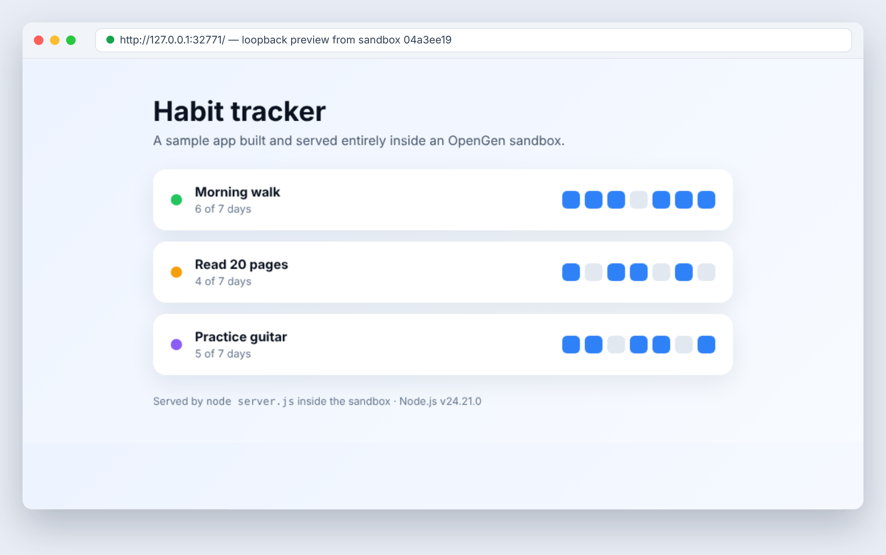
  <p><b>An app running in a sandbox.</b> A habit tracker served by <code>node server.js</code> inside the container, opened at its loopback preview URL.</p>
</td>
<td width="50%" valign="top">
  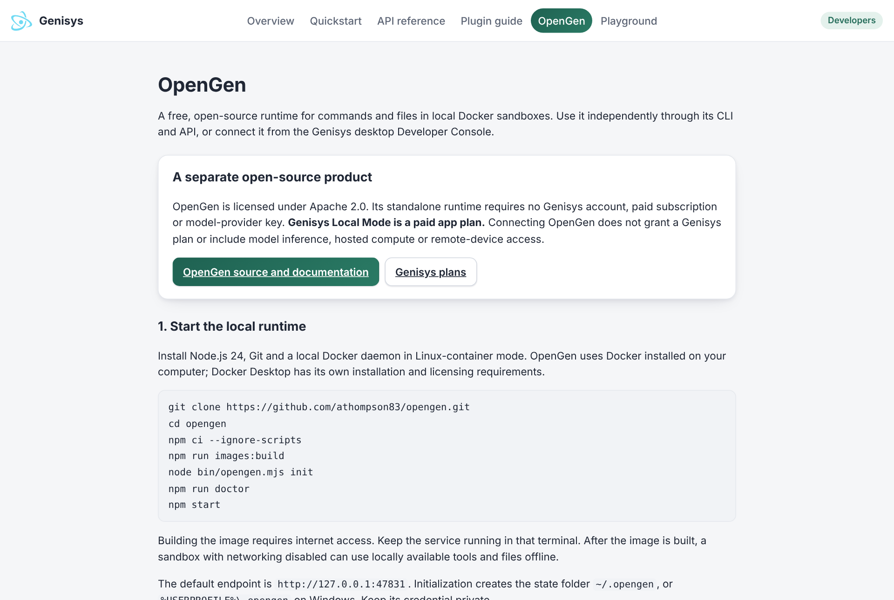
  <p><b>The Genisys developer guide.</b> Setup steps for connecting OpenGen to the Genisys desktop Developer Console, an optional separate app.</p>
</td>
</tr>
</table>

## The Genisys app

<p align="center">
  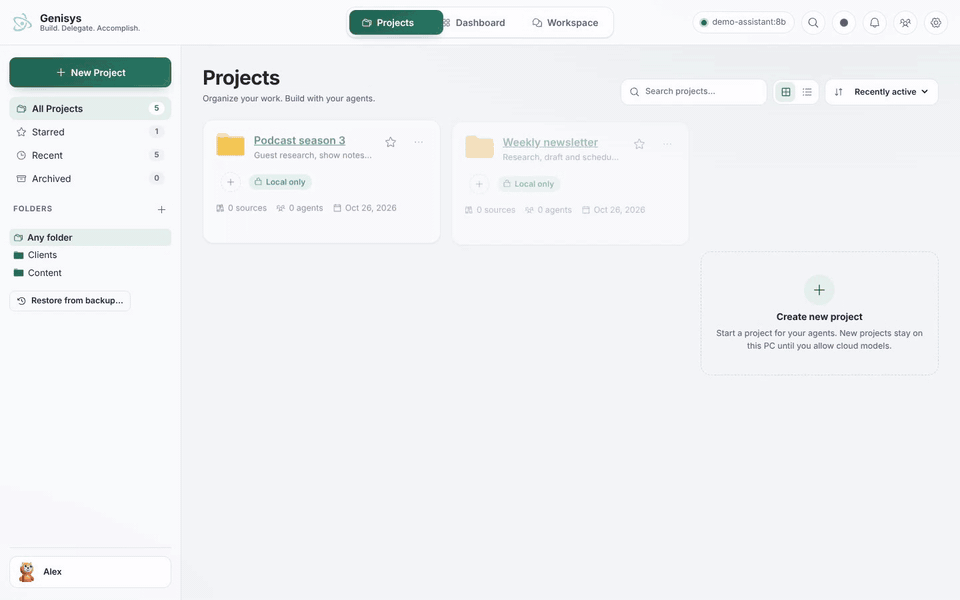
</p>

[Genisys](https://genisys.aroqon.com/) is a separate desktop app for running projects with a team of AI agents; it is one of the
client applications that can use OpenGen. OpenGen does not need it. These tutorials are recorded from the real Genisys
desktop build with a demo profile (a made-up coffee brand, synthetic tasks and a local stand-in model with a fixed reply),
so nothing in them touches a real account.

### 1. Set up Genisys

<table>
<tr>
<td width="62%" valign="top">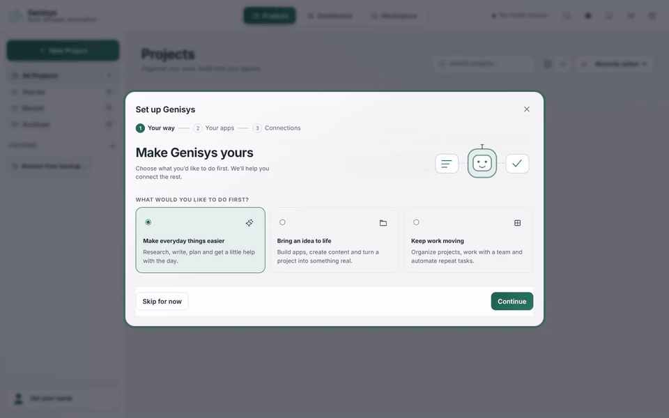</td>
<td width="38%" valign="top">
  <ol>
    <li>Open Genisys. Setup asks what you would like to do first; pick one and press <b>Continue</b>.</li>
    <li><b>Your apps</b> lists the supported creative, media and Office apps already on this PC.</li>
    <li><b>Connections</b> suggests services and asks how agents get AI: free models, your own keys or a Genisys account.</li>
    <li>Choose <b>Set up AI</b>, or <b>Do this later</b>. Nothing connects until you choose it.</li>
  </ol>
</td>
</tr>
</table>

### 2. Start a project

<table>
<tr>
<td width="62%" valign="top">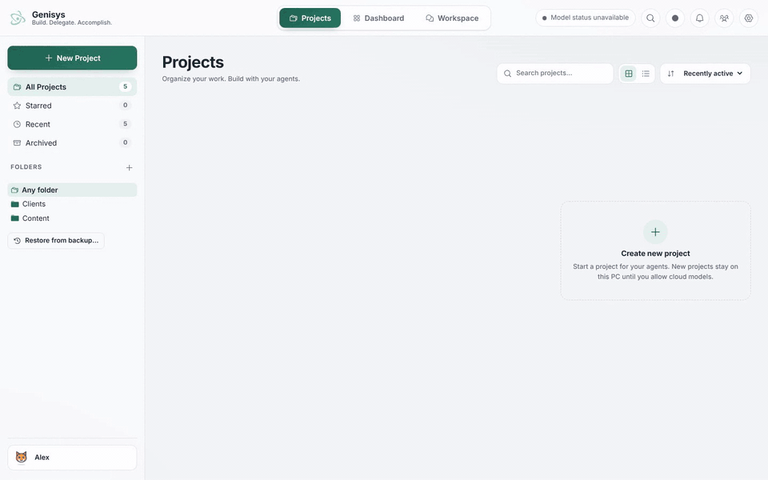</td>
<td width="38%" valign="top">
  <ol>
    <li>In <b>Projects</b>, star the work you come back to and file projects into folders.</li>
    <li><b>New Project</b> offers starting points: build and launch an app, start a business, explore an idea, design something, make a presentation, or manage what already exists.</li>
    <li>Open a project to see its task board: To do, Doing, Review and Done, each task with its agent or person.</li>
  </ol>
</td>
</tr>
</table>

### 3. Track work in a table

<table>
<tr>
<td width="62%" valign="top">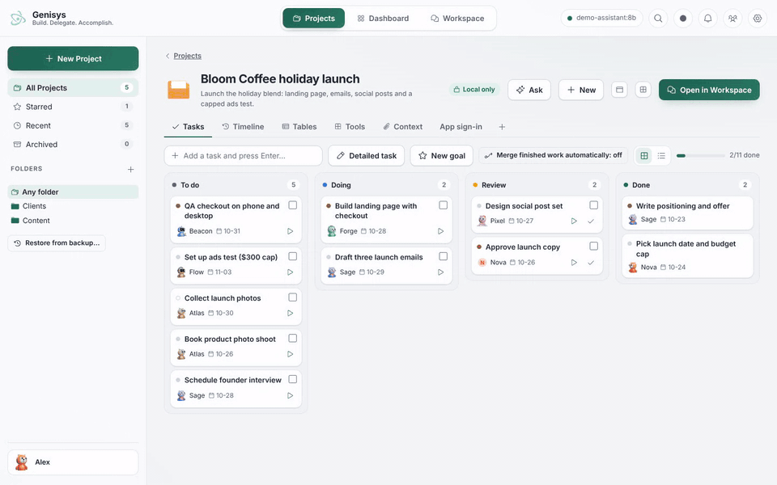</td>
<td width="38%" valign="top">
  <ol>
    <li>Open the project's <b>Tables</b> tab. Columns are typed: status, tags, people and agents, dates, numbers and calculations.</li>
    <li>Switch to <b>Board</b> to see rows as cards in a lane per status; drag a card or use its menu to move it.</li>
    <li>Switch to <b>Dashboard</b> for charts suggested from the table's columns.</li>
  </ol>
</td>
</tr>
</table>

### 4. See what's coming up

<table>
<tr>
<td width="62%" valign="top">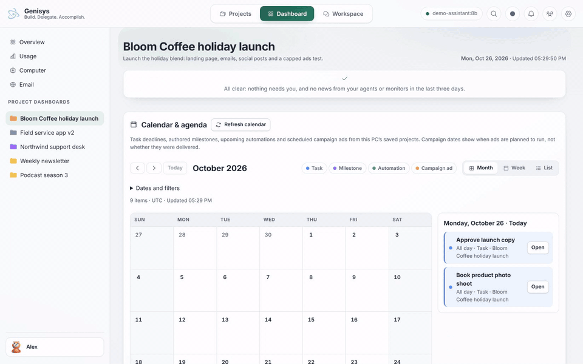</td>
<td width="38%" valign="top">
  <ol>
    <li>Open <b>Dashboard</b> and pick a project. <b>Calendar &amp; agenda</b> shows tasks, milestones, scheduled automations and planned campaign ads.</li>
    <li>Click a day, or move with the arrow keys, to list that day's items beside the month; <b>Open</b> takes you to the item.</li>
    <li>Use the arrows and <b>Today</b> to change month, and <b>Week</b> or <b>List</b> for other views. The coloured chips filter by kind.</li>
  </ol>
</td>
</tr>
</table>

### 5. Ask your agents

<table>
<tr>
<td width="62%" valign="top"></td>
<td width="38%" valign="top">
  <ol>
    <li>From a project, choose <b>Open in Workspace</b>. Your agents are on the left and the project's outputs on the right.</li>
    <li>Tell Zeus the result you want. Zeus plans the work and brings in teammates.</li>
    <li>The answer waits for your review: accept it or ask for a revision. Nothing is published or paid for until you approve it.</li>
  </ol>
</td>
</tr>
</table>

### 6. Build an automation from a template

<table>
<tr>
<td width="62%" valign="top">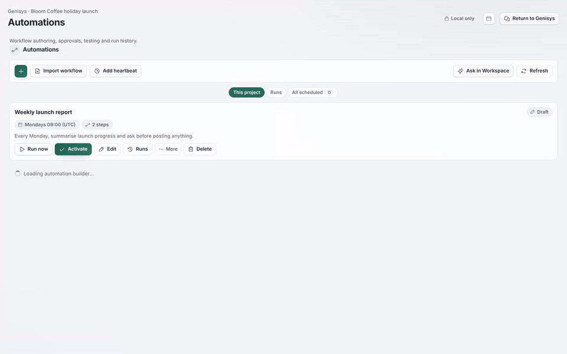</td>
<td width="38%" valign="top">
  <ol>
    <li>Open the project's <b>Automations</b> app and press <b>+</b> for a new automation.</li>
    <li>Open <b>Start from a template</b> and pick one, such as inbox triage, a support desk or a marketing campaign.</li>
    <li>The canvas shows its trigger and steps; <b>Simple list</b> shows the same steps in order.</li>
    <li><b>Create draft</b>, then test it and activate it yourself.</li>
  </ol>
</td>
</tr>
</table>

### 7. Edit a photo

<table>
<tr>
<td width="62%" valign="top">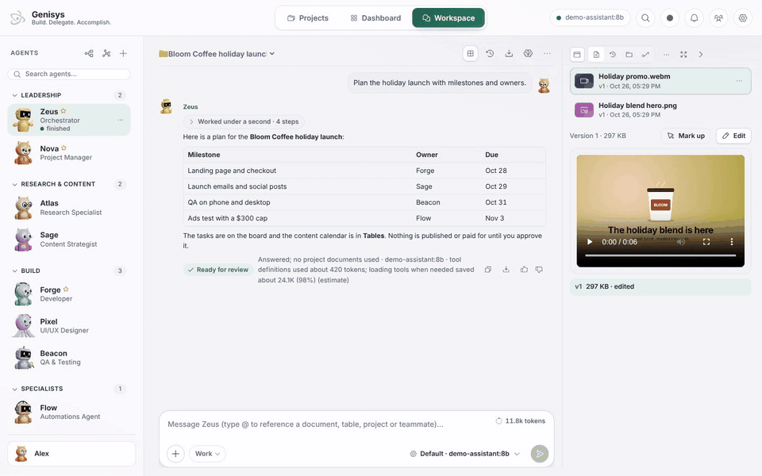</td>
<td width="38%" valign="top">
  <ol>
    <li>In the project's outputs, choose an image and press <b>Edit</b>.</li>
    <li>Pick a look, adjust light and colour, crop or turn it, and add a caption.</li>
    <li><b>Save version</b> keeps the original and adds the edit as a new version. Editing happens on this PC.</li>
  </ol>
</td>
</tr>
</table>

### 8. Reframe a video

<table>
<tr>
<td width="62%" valign="top">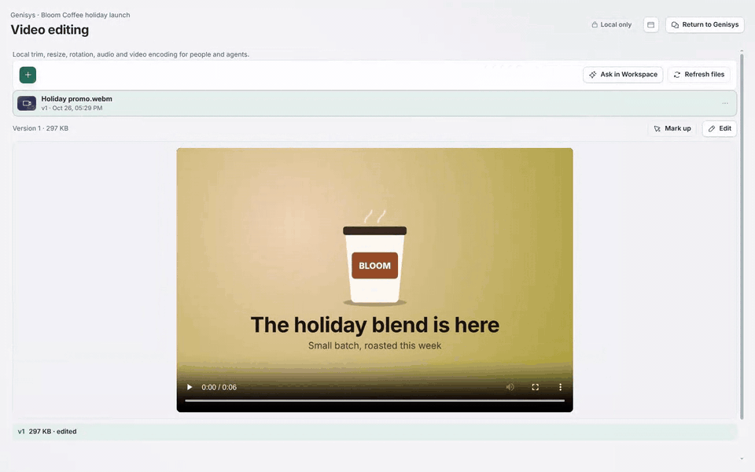</td>
<td width="38%" valign="top">
  <ol>
    <li>Open the project's <b>Video editing</b> app, choose a clip and press <b>Edit</b>.</li>
    <li>Pick a frame: portrait 9:16 for stories and reels, square 1:1 or landscape 16:9.</li>
    <li>Trim, add captions, remove sound or change size and format, then <b>Save version</b>.</li>
  </ol>
</td>
</tr>
</table>

### More of the interface

<table>
<tr>
<td width="50%" valign="top">
  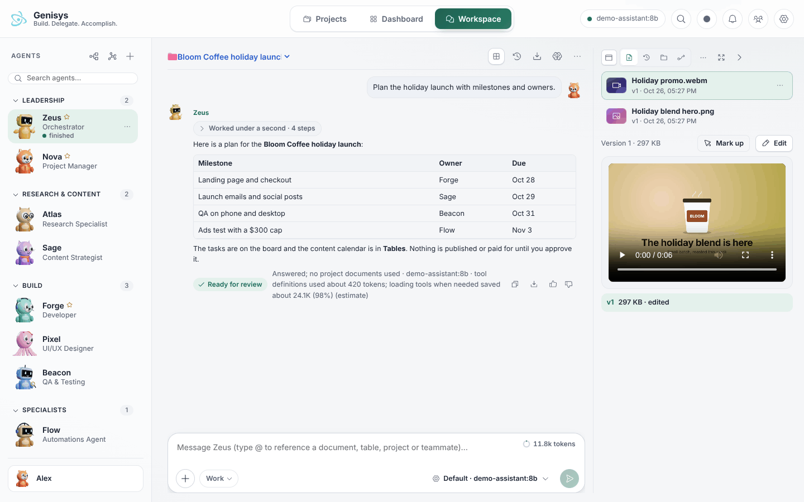
  <p><b>Workspace.</b></p>
</td>
<td width="50%" valign="top">
  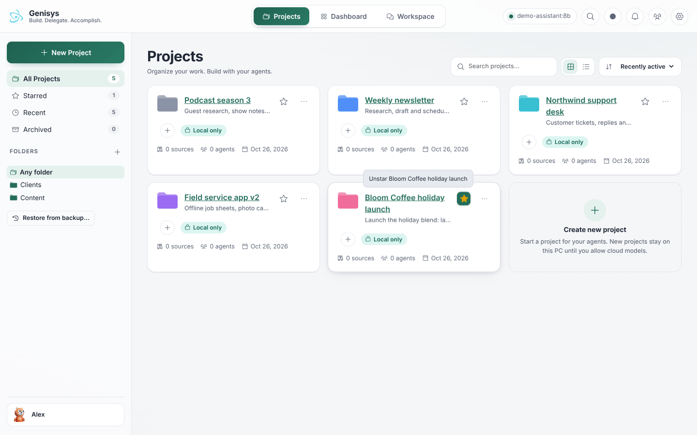
  <p><b>Projects and folders.</b></p>
</td>
</tr>
<tr>
<td width="50%" valign="top">
  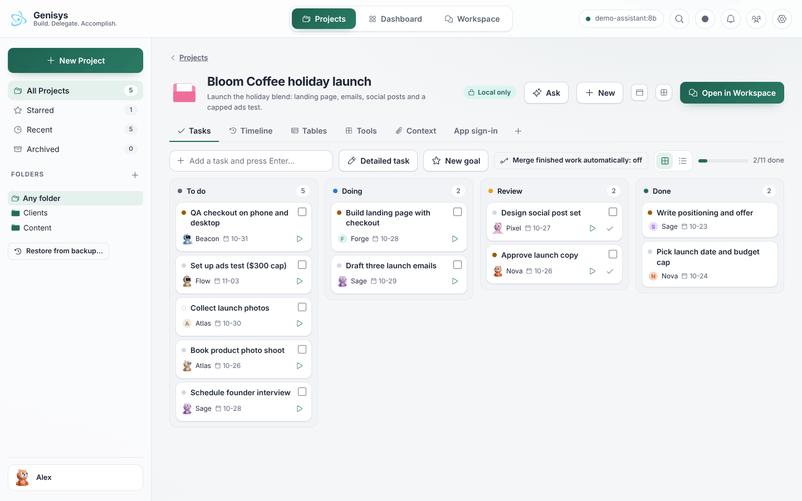
  <p><b>Task board.</b></p>
</td>
<td width="50%" valign="top">
  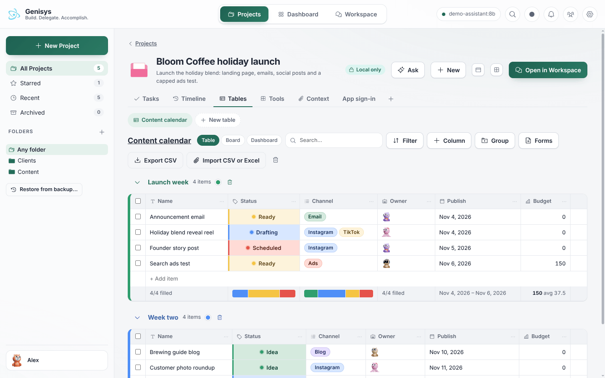
  <p><b>Tables.</b></p>
</td>
</tr>
<tr>
<td width="50%" valign="top">
  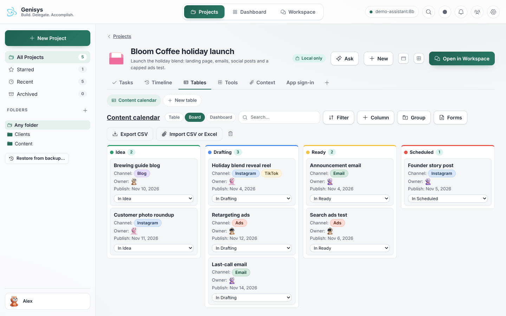
  <p><b>Table as a board.</b></p>
</td>
<td width="50%" valign="top">
  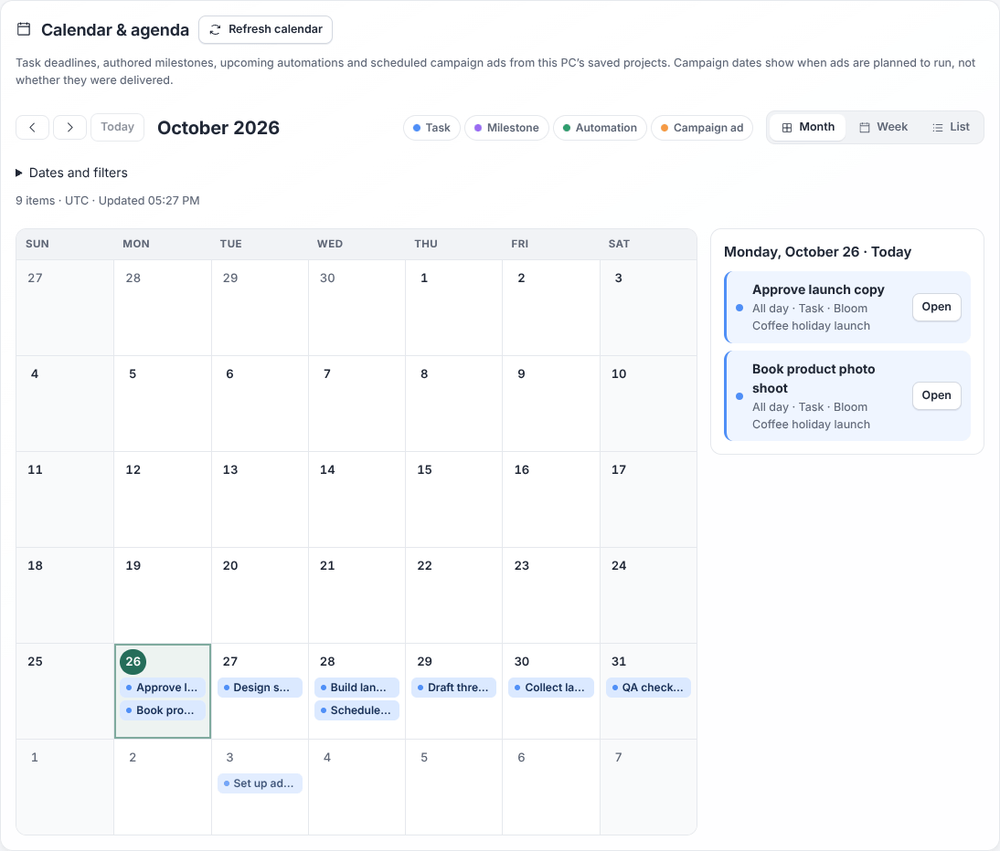
  <p><b>Calendar &amp; agenda.</b></p>
</td>
</tr>
<tr>
<td width="50%" valign="top">
  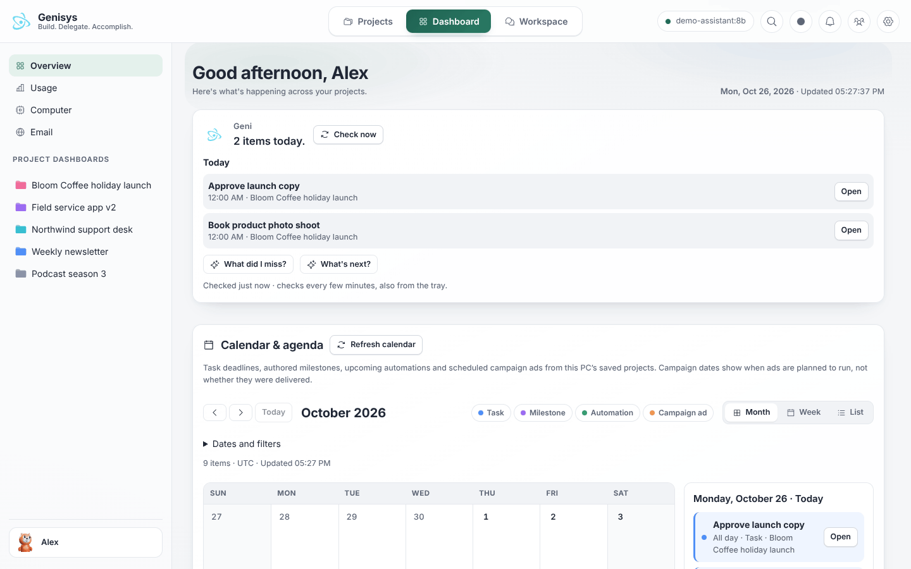
  <p><b>Dashboard.</b></p>
</td>
<td width="50%" valign="top">
  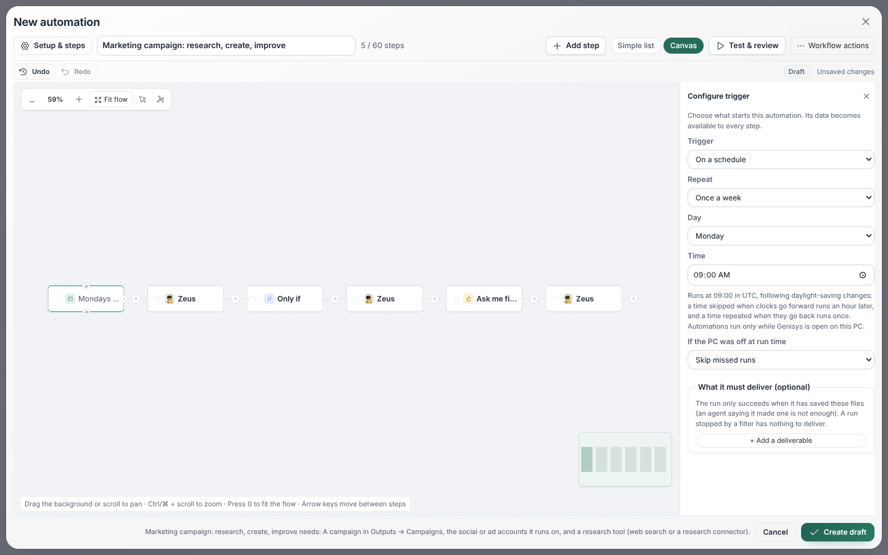
  <p><b>Automation canvas.</b></p>
</td>
</tr>
<tr>
<td width="50%" valign="top">
  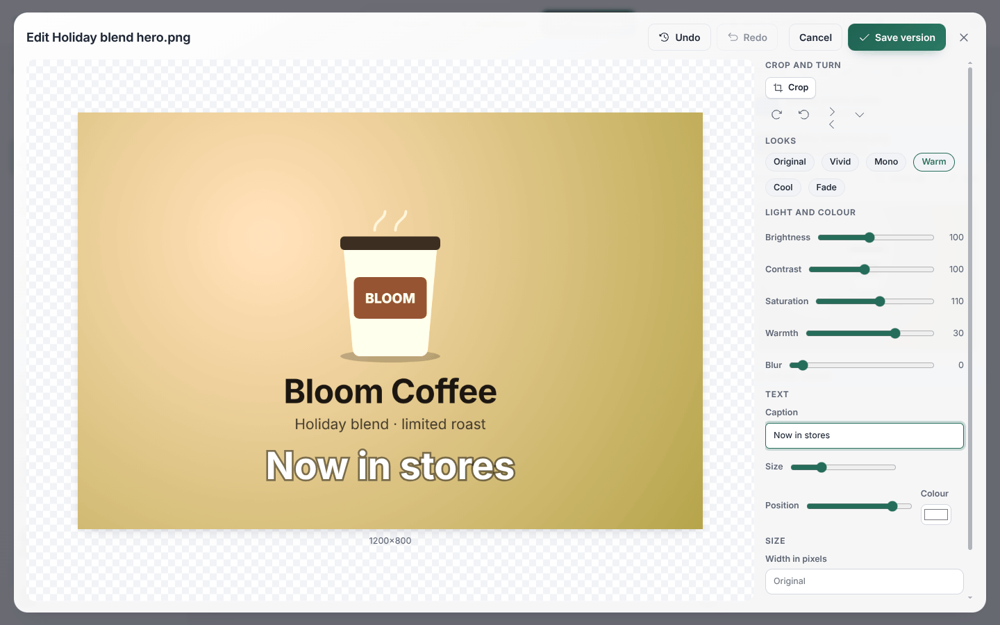
  <p><b>Photo editor.</b></p>
</td>
<td width="50%" valign="top">
  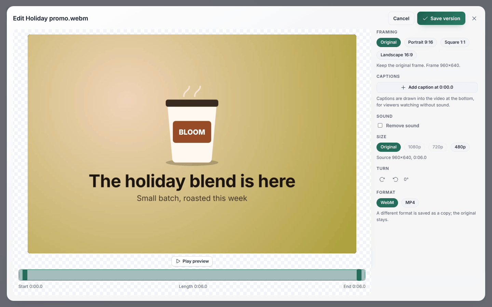
  <p><b>Video editor.</b></p>
</td>
</tr>
</table>

## Connections

Everything OpenGen connects to, and how far each connection is proven.

| | Connection | How OpenGen uses it | Status |
| :---: | --- | --- | --- |
|  | **Docker Engine (Linux)** | The container backend. OpenGen calls the Docker CLI directly and creates only its own managed containers and volumes | ✅ Verified in CI and `npm run test:docker` |
|  | **Docker Desktop (macOS, Windows)** | The same Docker CLI in Linux-container mode | ⚠️ Expected to work; not yet validated on those systems |
|  | **Linux host** | Where the CI and real-daemon suite run | ✅ Verified (Ubuntu CI) |
| 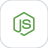 | **Node.js 24** | Runs the CLI, service and client; also the interpreter inside the sandbox image | ✅ Required and verified |
|  | **Official Node.js image (Debian Bookworm)** | Base of the sandbox image, `node:24.21.0-bookworm-slim` ([provenance](docs/THIRD_PARTY.md)) | ✅ Built and tested |
|  | **`opengen` CLI** | init, doctor, serve and every sandbox action, with JSON output | ✅ Tested |
|  | **HTTP API** | Loopback JSON API for any language or backend | ✅ Tested |
|  | **JavaScript client** | `@opengen/sandbox` ES module for trusted backend code | ✅ Tested; example recorded |
|  | **TypeScript** | Declarations in [`src/client.d.ts`](src/client.d.ts) | ✅ Included |
|  | **curl and other HTTP clients** | Call the API directly, as in Tutorial 3 | ✅ Recorded |
|  | **npm** | Install with the committed lockfile; run `check`, `test:docker`, `images:build` and `readme:record` | ✅ Used in CI |
| 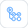 | **GitHub Actions** | One bounded Ubuntu verification job; publishes nothing | ✅ CI only |
|  | **Genisys desktop Developer Console** | An optional client application that uses the public API ([guide](https://genisys.aroqon.com/developers/opengen/)). Genisys Local Mode is a separate paid app plan; OpenGen stays free and independent | 🔗 Integration-tested in the Genisys repository |
| — | **OpenSandbox, microVM backends** | Future candidates behind the runtime interface | 🧭 Planned, not implemented |

Logos are trademarks of their owners and are shown only to identify compatible software. Icons are from
[Simple Icons](https://simpleicons.org/) (CC0-1.0); see [third-party provenance](docs/THIRD_PARTY.md).

## Use from another application

The public interface supports sandbox creation, command execution, file access, stop/start, reset, deletion and
local previews. Use the JavaScript client or the HTTP API from a trusted local backend process. Direct browser
requests are rejected.

- [API contract](docs/API.md)
- [Client application integration](docs/INTEGRATION.md)
- [Architecture](ARCHITECTURE.md)

Initialization creates local configuration and an authentication token in the OpenGen state directory. Keep the
token private: it grants access to every sandbox owned by this runtime. The provided image build refreshes its base
image and requires internet access. Once the image is built, offline workloads can run with locally available
tools and files.

Docker Desktop users should review its separate installation and licensing requirements; OpenGen does not
redistribute Docker Desktop. Use a dedicated development environment for workloads you do not trust.

## Verify

```sh
npm run check
npm run images:build
npm run test:docker
```

`check` verifies source behaviour without a Docker daemon, including that every image this README shows exists.
`test:docker` requires a real local Linux Docker daemon and the built image. It exercises:

- container configuration and lifecycle;
- file persistence;
- timeouts;
- project boundaries;
- preview binding.

See [verification](docs/VERIFICATION.md) for what the evidence does and does not establish.

CI runs one bounded Ubuntu job on relevant code changes. It does not run paid models, publish images or deploy
infrastructure. Passing Linux CI is not evidence that every desktop configuration works.

## Contributing

Contributions are welcome. Start with [CONTRIBUTING.md](CONTRIBUTING.md); the short version:

1. **Read the boundaries.** [AGENTS.md](AGENTS.md), [ARCHITECTURE.md](ARCHITECTURE.md) and [SECURITY.md](SECURITY.md)
   explain what the runtime must never do. For example, it never falls back to running commands on the host, and
   never accepts host mounts or Docker sockets from a client.
2. **Fork and clone,** then install with the lockfile:
   ```sh
   npm ci --ignore-scripts
   ```
3. **Make one focused change,** and add a regression test when behaviour or a security boundary changes.
4. **Run the checks:**
   ```sh
   npm run check                              # always
   npm run images:build && npm run test:docker  # images, lifecycle, files, execution or network changes
   ```
5. **Re-record the demos and tutorials** if you changed the CLI, API or image. This needs Docker, bash, curl and jq,
   and uses a private state directory:
   ```sh
   npm run readme:record
   ```
   Commit the updated SVGs.
6. **Open a pull request** that explains:
   - the behaviour being fixed;
   - the change;
   - which checks ran on a real Docker daemon and which used a test double.

Use built-in Node.js APIs unless a dependency solves a demonstrated problem. Record the provenance of anything you
copy from elsewhere. Never commit credentials, owner tokens, runtime state or private material. Report security
issues privately as described in [SECURITY.md](SECURITY.md).

## License

OpenGen is licensed under [Apache-2.0](LICENSE). See [NOTICE](NOTICE) and [third-party provenance](docs/THIRD_PARTY.md)
for external components.
